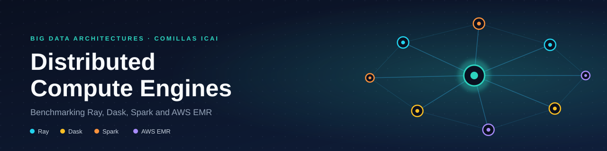
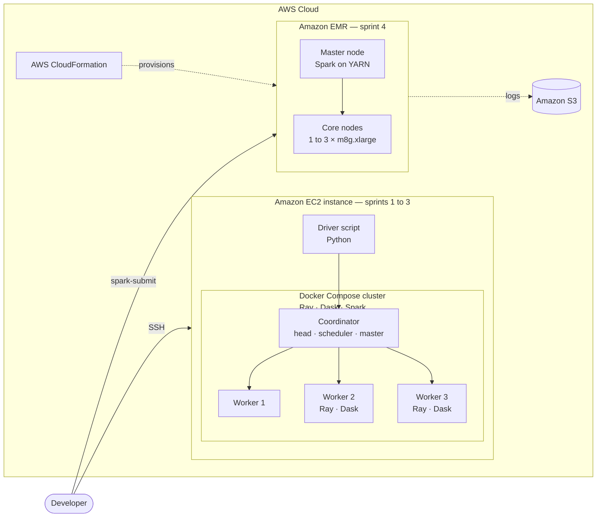

<p align="center">
  
</p>

<p align="center">
    
  
  
  
  
  
  
</p>

# Distributed Compute Engines

**Development period:** September-December 2025

A hands-on benchmark of three distributed computing engines (**Ray**, **Dask** and **Apache Spark**) across four deployments on **AWS**. Each engine runs the same Monte Carlo workload in Docker clusters on an Amazon EC2 instance, and Spark also runs on a managed **Amazon EMR** cluster.

The project was developed for the **Big Data Architectures course at Universidad Pontificia Comillas (ICAI)** and was built incrementally over four sprints, each adding a new engine or deployment target.

## Overview

All engines estimate **π with the Monte Carlo method**. The work is split into 200 independent tasks; each task samples random points in the unit square and counts how many fall inside the quarter circle:

```
π ≈ 4 × (points inside the circle / total points)
```

Because the algorithm is identical across engines, differences in execution time and throughput reflect the engines and their deployment, not the workload. Each run reports the estimated π, wall-clock time and throughput in points per second.

| Sprint | Engine | Deployment | Workload sizes |
|:------:|--------|------------|----------------|
| 1 | Ray | Amazon EC2 + Docker Compose — 1 head and 3 workers | 5, 10, 50 M points |
| 2 | Dask | Amazon EC2 + Docker Compose — 1 scheduler and 3 workers | 5, 10, 50 M points |
| 3 | Apache Spark and HDFS | Amazon EC2 + Docker Compose — master, worker, namenode, datanode, Jupyter | 5, 10, 50 M points |
| 4 | Apache Spark on AWS EMR | CloudFormation — 1 master and up to 3 core nodes (`m8g.xlarge`) | 50, 100, 500 M points |

## Architecture

Every deployment follows the same coordinator–worker pattern: a driver submits tasks to a coordinator (Ray head, Dask scheduler, Spark master or YARN), which distributes them across workers and gathers the partial counts.



- **Sprints 1–3** run on a single EC2 instance. Each engine is deployed as a Docker Compose cluster, and each container is pinned to a CPU.
- **Sprint 4** moves the Spark job to a managed Amazon EMR cluster, provisioned as infrastructure as code with CloudFormation.

## Repository structure

```
|
├── 01-ray/          Ray cluster and driver script
├── 02-dask/         Dask cluster and driver script
├── 03-spark/        Spark and HDFS cluster, driver script
├── 04-aws-emr/      CloudFormation template and Spark job for EMR
└── docs/            Project documentation and sprint reports
```

## Getting started

**Requirements:** an AWS account, an EC2 instance with Python 3.10 or later and Docker with Compose (sprints 1–3), and permissions to create CloudFormation stacks (sprint 4).

```bash
git clone https://github.com/<your-username>/distributed-compute-engines.git
cd distributed-compute-engines

python -m venv .venv
source .venv/bin/activate        # Windows: .venv\Scripts\activate
pip install -r requirements.txt
```

### Sprint 1 — Ray

```bash
cd 01-ray
cp .env.example .env             # adjust values if needed
docker compose up -d
python montecarlo_ray.py
```

### Sprint 2 — Dask

```bash
cd 02-dask
docker compose up -d
python montecarlo_dask.py        # dashboard on port 8787 of the instance
```

### Sprint 3 — Spark

```bash
cd 03-spark
cp .env.example .env             # set a Jupyter password and token
docker compose up -d --build
```

Run `montecarlo_spark.py` with `spark-submit` against `spark://spark-master:7077`, or from the Jupyter container. The Spark UI is available at `http://<instance-address>:8080`.

The compose file builds its images from the `hadoop/`, `spark/` and `jupyter/` directories, which are not included in this repository. These directories must be provided before the sprint 3 cluster can be started. In addition, the `JAVA_HOME` path in the Jupyter service targets an ARM64 image and should be adjusted for other architectures.

### Sprint 4 — AWS EMR

```bash
aws cloudformation deploy \
  --template-file 04-aws-emr/emr-cluster.yaml \
  --stack-name distributed-compute-emr \
  --capabilities CAPABILITY_IAM \
  --parameter-overrides VpcId=<vpc-id> SubnetId=<subnet-id> KeyName=<key-pair> InstanceCount=3
```

Submit `04-aws-emr/montecarlo_spark_emr.py` as a Spark step, or run it from the master node. Replace the log bucket in the template with your own.

## Documentation

Project documents are in [`docs/`](docs) and are written in Spanish:

- [User stories](docs/user-stories.pdf)
- [Architecture project](docs/architecture-project.pdf)
- Sprint reports: [1](docs/reports/sprint-1.pdf) · [2](docs/reports/sprint-2.pdf) · [4](docs/reports/sprint-4.pdf)
- [Docker deployment guide](docs/reports/docker-deployment.pdf)

## Security

Credentials, `.env` files and private keys must never be committed. They are excluded through `.gitignore`; configuration templates are provided as `.env.example`.

## Authors

- Jorge Carnicero Príncipe
- Jorge González Pérez
- Andrés Gil Vicente

## License

Released under the [MIT License](LICENSE).
